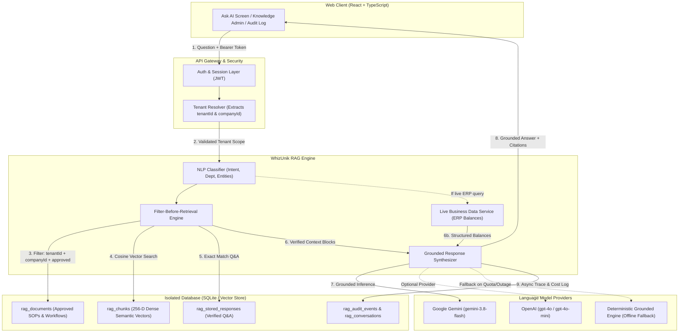
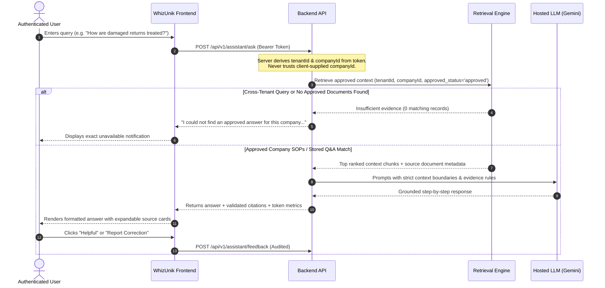

# WhizUnik AI Layer (Multi-Tenant RAG)

A secure, company-isolated **Retrieval-Augmented Generation (RAG)** assistant for the WhizUnik operating platform. It answers operational, process, and financial queries using only approved company workflows, standard operating procedures (SOPs), verified Q&A, and live business data—without hallucinating or leaking data across tenants.

---

## Architecture Diagram



---

## User Flow Diagram



---

## Core Capabilities

1. **Strict Multi-Tenant Isolation:**
   Every query applies `WHERE tenant_id = ? AND company_id = ? AND approved_status = 'approved' AND is_deleted = 0` before vector ranking. Cross-company access is blocked at the database level.
2. **Hybrid Semantic Retrieval:**
   Combines 256-D normalized semantic vector similarity, token n-grams, keyword frequency ratios, and department/intent alignment boosts.
3. **Fail-Safe Hosted Generation:**
   Powered by **Google Gemini** (`gemini-3.8-flash`) via an OpenAI-compatible endpoint. Automatically falls back to an internal deterministic synthesizer if network errors or quota limits occur.
4. **Exact Unavailable Fallback:**
   If a user asks about unapproved policies or foreign company processes, the system returns:
   > *"I could not find an approved answer for this company. Please contact the relevant department or add this process to the company knowledge base."*
5. **Knowledge Base Governance & Audit:**
   Full UI at `/knowledge` for document upload, approval, version history, and verified Q&A creation. Comprehensive trace logs at `/audit` record request latency, tokens, cost, and cited source IDs.

---

## Demo Companies & Logins

Password for all accounts: **`Demo@12345`**

| Company | Email | Industry | Example Question |
|---|---|---|---|
| **RFB Latex** | `admin@rfblatex.demo`<br/>`returns@rfblatex.demo` | Medical gloves manufacturing | *"What is the process for damaged return goods?"*<br/>*"When is an invoice generated?"* |
| **Alpine Retail** | `admin@alpineretail.demo`<br/>`marketplace@alpineretail.demo` | E-commerce & marketplace | *"How is stock reserved for a marketplace order?"*<br/>*"How are marketplace returns handled?"* |
| **Demo Manufacturing Co.** | `admin@demomfg.demo`<br/>`warehouse@demomfg.demo` | Industrial equipment | *"How is a GRN created?"*<br/>*"How is material issued for production?"* |

*Try querying RFB Latex's Quarantine Bay Q-2 from an Alpine Retail session to verify cross-tenant blocking.*

---

## Quick Start

Requires **Node.js 20+**.

```bash
# 1. Install dependencies
npm install
npm run install:all

# 2. Seed demo companies, documents, and 21 standard questions
npm run seed

# 3. Start development servers (Backend :4000, Frontend :5173)
npm run dev

# 4. Run automated test suite (322 tests across 7 test files)
npm test
```

### Environment Configuration (`backend/.env`)

```env
PORT=4000
CORS_ORIGINS=http://localhost:5173
JWT_SECRET=change-me-in-production-use-a-long-random-string
DATABASE_PATH=./data/whizunik.db

# AI Provider Configuration (Google Gemini / OpenAI)
AI_PROVIDER=gemini
GEMINI_API_KEY=<your-key>
OPENAI_API_KEY=<your-key>
OPENAI_BASE_URL=https://generativelanguage.googleapis.com/v1beta/openai
AI_MODEL_FAST=gemini-3.8-flash
AI_MODEL_STRONG=gemini-3.8-flash
AI_TIMEOUT_MS=30000
```
